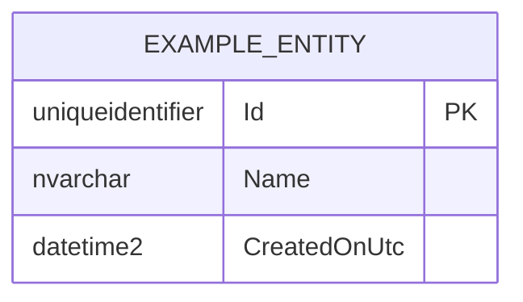

# Catalog module

| | |
|---|---|
| Code | `src/Modules/Catalog` |
| Schema | `catalog` |
| Route prefix | `/api/catalog` |
| Owners | `@8ashraf/catalog-team` |

## Responsibility
What this module owns — and what it explicitly does not.

## Public contract
Integration events published (`Shop.Modules.Catalog.IntegrationEvents`):

| Event | When | Consumers |
|---|---|---|

Integration events consumed:

| Event | From module | Reaction |
|---|---|---|

## Data model

